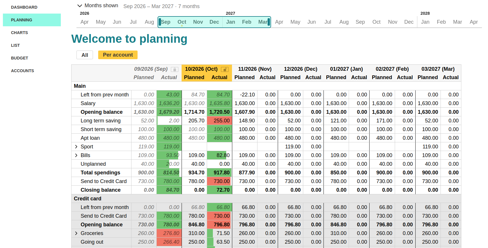
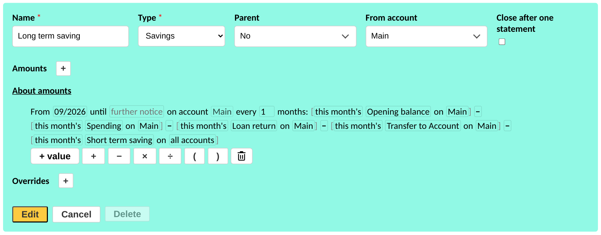
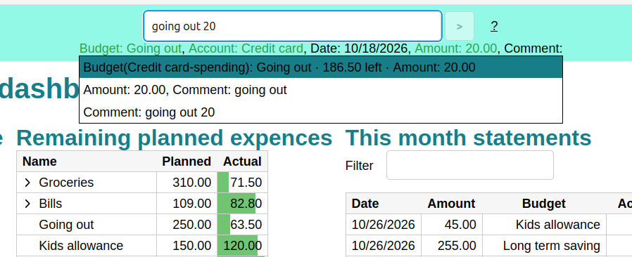
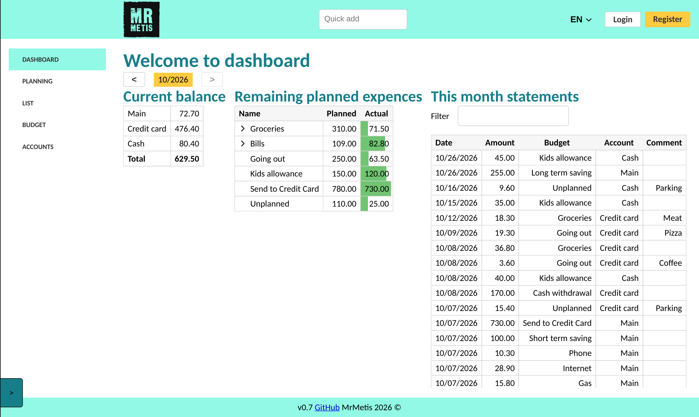

  

<h1 align="center">MrMetis</h1>

  <b>Plan your money months ahead, and see where it actually went.</b> 
  A private, open-source budget planner for people who like their numbers to add up.

  <a href="https://mrmetis-qa.romkats.eu"><b>▶ Try the live demo</b></a>
  &nbsp;·&nbsp;
  <a href="https://github.com/ro-mat/MrMetis/issues">Request a feature</a>
  &nbsp;·&nbsp;
  <a href="DEVELOPMENT.md">Run it yourself</a>

  

---

## Why MrMetis?

Most budgeting apps tell you what you **already** spent. MrMetis is built around what you **will** spend: you write down your income, bills, savings and transfers once, and it lays out your next months for you. As the month goes on, every statement you add is set against the plan, so you see right away which items are on track and which have run over.

And your data stays yours. Everything is encrypted in your browser before it is sent anywhere. The server can't read your budget, and neither can we.

## Features

### 📅 Plan months ahead

The planning table shows every budget item, month by month, with **planned** and **actual** amounts side by side. Opening balance, total spending and closing balance are worked out for each month. Whatever is left at the end of a month rolls into the next one. View all your accounts together, or one at a time.

### 🧮 Amounts that work themselves out

A budget amount doesn't have to be a fixed number. Build it from other budget items, totals of a type (all spending on an account, for example), the number of days in the month, or how many Fridays it has, and combine them with `+ − × ÷`. You can use this month's values or last month's.

Savings can be *"whatever is left after spending, loans and transfers"*. Gym visits can be *"8 × number of Tuesdays"*. When something changes, the plan updates itself.

  

Recurring items can repeat every *n* months, have start and end dates, and take one-off overrides for a single month.

### ⚡ Add a payment in seconds

Type `gro`, Tab, `credit`, Tab, `12.5`, Tab, `yesterday`, Tab, then a comment, and press Enter. Quick add sits at the top of every page and suggests budgets, accounts and dates as you type.

  

### 📊 See where you stand today

The dashboard shows your current balance on every account, what's still left to spend in each budget, and this month's statements.

  

### And also

- **Multiple accounts and transfers**: a main account, a credit card and cash, with planned transfers between them.
- **Nested budgets**: group Electricity, Water and Gas under Bills.
- **Close a month** when it's done, so old numbers stay as they were.
- **Your formats**: date order, separators, currency symbol and decimals all follow your preferences. Available in English and Russian.
- **Export and import** to CSV or JSON at any time. Your data isn't locked in.
- **Auto logout** when you're away from the screen.

## Your data is private by design

|                                  | MrMetis | Typical budgeting apps  | Spreadsheets         |
| -------------------------------- | :-----: | :---------------------: | :------------------: |
| Data encrypted on your device    | ✅      | ❌ the provider can read it | depends where you keep it |
| Plans months ahead, not just tracks | ✅   | partly                  | ✅ if you build it   |
| Amounts calculated from other items | ✅   | ❌                      | ✅ with formulas to maintain |
| Planned and actual side by side  | ✅      | partly                  | ✅ if you build it   |
| Needs your bank login            | ❌      | sometimes               | ❌                   |
| Free and open source             | ✅      | ❌ usually a subscription | —                 |

How it works:

- Your budget is encrypted in the browser with **AES-256-GCM** before it is saved. The key comes from your password and never leaves your device.
- The server stores only your email address in readable form. Everything else is ciphertext.
- No bank connections, no ads, no selling or sharing of data.
- The code is open ([GPL-3.0](LICENSE.txt)), so you can check all of this yourself. The full walkthrough is on the [How your data is encrypted](https://mrmetis-qa.romkats.eu/encryption) page.

## Try it

👉 **[Open the demo](https://mrmetis-qa.romkats.eu)** and press **Try Demo**. You don't need an account. The demo comes with a sample household budget that you can change as much as you like. Demo data stays in your browser.

MrMetis is in **closed beta**: registration needs an invitation code. You can also [run it locally](DEVELOPMENT.md) in a few minutes.

## Roadmap

- [x] **First release** (May 2023): planning table, dashboard, statements, quick add and a demo budget, in English and Russian.
- [x] **Smart amounts** (January 2024): a new calculation engine. Amounts built from other items, type totals and weekdays, and budget items across several accounts.
- [x] **Rebuilt app** (October 2026): reworked forms, backend and layout, and updated in-browser encryption.
- [x] **Closed beta** (October 2026): export and import, closing months, charts, and the live demo with registration by invitation.
- [ ] **Production launch**: a public production site, separate from the demo.
- [ ] **Persistent data option**: choose to keep your data saved between sessions.
- [ ] **Self-hosting option**: run MrMetis on your own server.
- [ ] **Shared account**: share a budget with a partner or your household.
- [ ] **Bank data import**: import statements from your bank's export files. Still no bank login.

Missing something? [Request a feature](https://github.com/ro-mat/MrMetis/issues).

## Feedback

Found a bug or missing something? [Open an issue](https://github.com/ro-mat/MrMetis/issues). Ideas and pull requests are welcome.

Developers: see [DEVELOPMENT.md](DEVELOPMENT.md) for local setup, the QA environment and database migrations.
